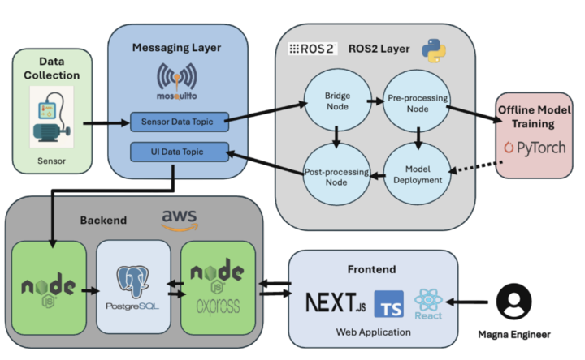
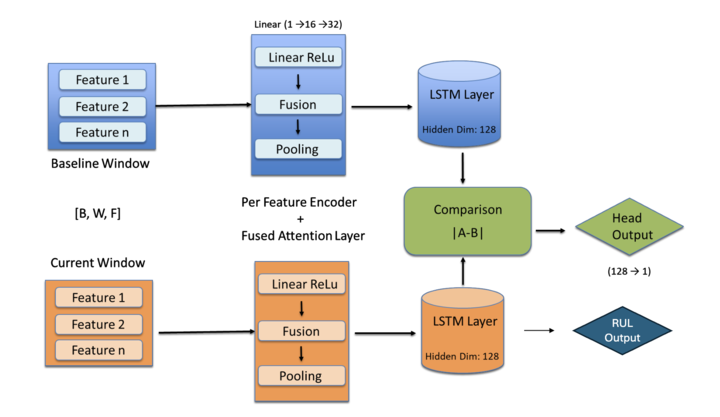

# ML/AI Pipeline for Condition-Based Maintenance

# Team Magna AI4CBM

Hello, we are Team Magna AI4CBM. We completed this project Fall of 2025 for the MSU Capstone Experience(CSE498).

Members:

Daniel Chen, Bloomfield Hills, Michigan

Athul Syam, Rochester Hills, Michigan

Michael Gryn, Shelby Township, Michigan

Lizabeth Hanks, Farmington Hills, Michigan

Ethan Springer, Hudsonville, Michigan

Hector Dominguez Rojas, Rochester Hills, Michigan

# This project implements a complete Condition-Based Maintenance ROS2 pipeline using:

* ROS2 (Humble)

* MQTT (HiveMQ / Mosquitto)

* Feature preprocessing + scaling

* ML inference for anomaly detection + RUL

* Optional simulation mode using IMS vibration datasets

# The pipeline performs:

* Data ingestion (MQTT → ROS2)

* Preprocessing, buffering, scaling, windowing

* Model inference (Siamese LSTM)

* Publishing (MQTT)

# Architecture

# Model Architecture

# Pipeline overview

The pipeline is designed and built within the Robot Operating System 2
framework. There is an ingestion bridge node to receive MQTT messages from a
designated broker and convert the messages into the necessary ROS2 format. The
pre-processing node takes in these data points and formats them into windows
per data stream per machine. Once these windows fill per machine, the windows
are chosen from the selected flags for the wanted data types to be sent to the
model. Once the model receives these windows of data and the associated data
types, it makes a prediction on the remaining useful life of the machine and does
a comparison from the current window to a baseline window for a binary
anomaly detection. The post-processing node takes these results as well as the
raw data and packages them to be sent to a different MQTT topic within the
broker for the backend of the dashboard to receive.

# Nodes in the pipeline

| **ROS2 Node (File Name)** | **Primary Function and Capabilities**                                                                                                                                                                                                                                                                          |
| :--- |:---------------------------------------------------------------------------------------------------------------------------------------------------------------------------------------------------------------------------------------------------------------------------------------------------------------|
| **Bridge Node (mqtt_bridge.py)** | Subscribes to an MQTT broker, reformats incoming messages, timestamps JSON payloads, normalizes topic paths, and republishes them into the ROS2 workspace. Also listens for ROS2 control messages to update broker settings (host, port, TLS, username/password).               |
| **Pre-Processing Node (preprocessing.py)** | Subscribes to the raw sensor\_topic, aggregates machine data into rolling windows per machine/sensor, scales values using pre-fitted scalers, and publishes structured windowed data for the model node. Also listens for control messages to reset baselines and set feature usage (max, rms, std, kurtosis). |
| **Model Deployment Node (model.py)** | Subscribes to preprocessed\_topic, converts incoming windowed data into tensors, runs inference to detect anomalies and estimate remaining useful life (RUL), and publishes the results on prediction\_topic.                                                                                                  |
| **Post-Processing Node (post\_processing.py)** | Listens to both the model prediction stream and the raw sensor stream, pairs each message with parsed IDs from the topic path, and republishes them to HiveMQ Cloud on dedicated topics.                                                                                                                       |
| **Control Node (control\_node.py)** | Listens on a control MQTT topic for simple JSON commands from the UI dashboard, validates the payloads, and forwards them as structured control messages into ROS.                                                                                                                                             |

# Installing the project

### Requirements

* Ubuntu 22.04

* ROS2 Humble

* Python 3.10

### Installing Next.js

**DO ALL THESE ONCE ON INITIAL PULL:**  
-Add the .env file (as shown below) 
-Then open the terminal then cd into the 'website-app' directory  
-Then run npm i, this will download all the dependencies, only need to do this once ( not everytime you open localhost)  
 
**HOW TO CREATE .env FILE:**  
Create file 'UI Dashboard/Next.js prototype/website-app/.env' 
Add the following content to file: 
 
GOOGLE_CLIENT_ID= 
GOOGLE_CLIENT_SECRET= 
NEXTAUTH_URL=http://localhost:3000 
NEXTAUTH_SECRET= 
ALLOWED_EMAILS= 
RESEND_API_KEY= 
 
To get the Google Client ID and Secret you will need to make an account on Google Cloud Console. This is used for
the sign in functionality, as we use a 'Sign In With Google' button. 
 
Nextauth url and secret is also used for authentication. Nextauth is what interacts wwith Google Cloud Console for
authentication. Nextauth has a lot of authentication options, however, 'Sign In With Google' was the chosen option. 
 
Resend api key is used for sending emails, we use this for our notification system. 
 
**DO THESE EVERYTIME WANTING TO RUN WEBSITE:** 
-To open the localhost write 'npm run dev' into the terminal while in the 'website-app' directory  
-Open localhost:3000 in browser to open UI 

# Model Training and Deployment

Prior to running the pipeline, the model will need preprocessing and training.

First run IMS_preprocessing.py found at IMS/IMS_preprocessing.py

Then run model.py found at IMS/model.py

Now we need to import the model into ROS2.

Copy and paste the following files into this directory: ros2_ws/src/mqtt_ros_bridge/mqtt_ros_bridge

* IMS/model_state.pt
* IMS/model_scripted.pt
* IMS/data/scalers.pkl

# Broker Configuration

There are three brokers connections within the pipeline that will need to be configured.

First go to: ros2_ws/src/mqtt_ros_bridge/mqtt_ros_bridge/mqtt_bridge.py

Update the variables to match the broker you want to subsribe to. This broker is the same broker that your sensors will be publishing to.

Now lets work on publishing data from the pipeline. 

Go to: ros2_ws/src/mqtt_ros_bridge/mqtt_ros_bridge/post_processing.py

Change these broker settings to be the broker you wish to publish model predictions too. This will be the same broker that you connect to via the dashboard.

Finally, go to: ros2_ws/src/mqtt_ros_bridge/mqtt_ros_bridge/control_node.py

Make sure these broker settings match what you selected in post_processing.py

# Mirroring a windows workspace into Ubuntu

Using a command similar to what is below, you will be able to mirror required files into a Ubtuno ROS2 WS

rsync -a --delete \

  --exclude ".git/" --exclude ".idea/" \

  --exclude "__pycache__/" --exclude ".venv/" --exclude "venv/" \

  [PATH TO AI4CBM] ~/ai4cbm/

# Building and Running

Now that everything is safely in our ROS2 workspace we can build the pipeline using the following command

cd ~/ros2_ws

colcon build --symlink-install

source /opt/ros/humble/setup.bash

source install/setup.bash

The following command will launch the pipeline:

ros2 launch mqtt_ros_bridge pipeline.launch.py

# Simulation

Before running the simulation mode, first we need to update the broker settings in the following file:

ros2_ws/src/mqtt_ros_bridge/mqtt_ros_bridge/simulation_test.py

Make these settings match the broker settings in: ros2_ws/src/mqtt_ros_bridge/mqtt_ros_bridge/mqtt_bridge.py

Now that the brokers are configured, the simulation mode can be launched by the following command:

ros2 launch mqtt_ros_bridge pipeline.launch.py run_sim:=true

# Backend Overview
The backend runs on an AWS EC2 instance and handles ingestion of raw machine data and
model output, storing both in a PostgreSQL database. It connects to an MQTT broker using
user-provided frontend credentials and exposes the API endpoints used by the frontend.
## Architecture Summary
- Two Node.js services:
- backend.js :
- Creates an Express app that handles all API requests from the frontend.
- API calls query the PostgreSQL database and return the requested data
to the frontend.
- server.js :
- Connects to an MQTT broker through HiveMQ.
- Connection information — host, port, username, and password — is
obtained from the frontend after the user logs into the application.
- Once connected, server.js listens for incoming messages from the MQTT
broker and inserts each message into the appropriate tables in the
PostgreSQL database.
- PostgreSQL database with 5 tables
- MQTT broker used as the source of incoming machine data for the backend
## Setup (Local)
1. Install PostgreSQL on your machine
2. Create the database and the required tables
3. Add database credentials in both backend/db.js and mqtt_subscriber/mqtt_subscriber.js
4. Install project dependencies
npm install
5. Start backend services locally
node backend.js
node server.js
## Setup (AWS EC2)
1. Create and configure an AWS EC2 instance
2. SSH into the instance and pull the repository:
git clone <repo_url>
cd <project_folder>
npm install
3. Start both node services using pm2
pm2 start backend.js
pm2 start server.js
4. Enable pm2 startup so services automatically restart after system reboots:
pm2 startup
pm2 save
## Database Tables
- `raw_sensor_readings` - List of the raw sensor readings
- `model_output` - List of model output (anomaly detected and rul) per machine
- `admin_list`- List of admin emails
- `notification_list` - List of user emails and the machine they should be notified about
- `mqtt_broker_user_connections` - Maps user Google IDs to their MQTT broker
connection details

## Database Structure

Database name - cse486

### raw_sensor_readings: 

| Column           | Type     |Description  |
| :--- | :--- | :--- |
| time_stamp       | TIMESTAMP | The date and time the data was recorded from the sensor       |
| topic_path       | VARCHAR   | The MQTT topic path that the message was published to         |
| division_id      | VARCHAR   | The identifier for the division the machine belongs to        |
| line_id          | VARCHAR   | The identifier for the line the machine belongs to            |
| machine_id       | VARCHAR   | Identifier for the machine                                    |
| machine_feature  | VARCHAR   | The specific type of measurement being recorded for the machine |
| value            | NUMERIC   | The recorded measurement of the machine feature               |
| broker           | VARCHAR   | A combination of the broker host and port in a string         |
| plant_id         | VARCHAR   | The identifier for the plant the machine belongs to           |
| area_id          | VARCHAR   | The identifier for the area the machine belongs to            |
| subarea_id       | VARCHAR   | The identifier for the subarea the machine belongs to         |
| station_id       | VARCHAR   | The identifier for the station the machine belongs to         |
| machine_type_id  | VARCHAR   | Identifier representing the type of the machine

### model_output:

| Column | Type | Description |
| :--- | :--- | :--- |
| time_stamp       | TIMESTAMP | The date and time the data was recorded from the sensor                     |
| topic_path       | VARCHAR   | The MQTT topic path that the message was published to                       |
| division_id      | VARCHAR   | The identifier for the division the machine belongs to                      |
| line_id          | VARCHAR   | The identifier for the line the machine belongs to                          |
| machine_id       | VARCHAR   | Identifier for the machine                                                  |
| machine_features | JSONB     | A list of machine features the model used to predict the machine's health   |
| model_output_value | BOOL    | `1` if an anomaly is detected for the machine; otherwise `0`                |
| broker           | VARCHAR   | A combination of the broker host and port in a string                       |
| plant_id         | VARCHAR   | The identifier for the plant the machine belongs to                         |
| area_id          | VARCHAR   | The identifier for the area the machine belongs to                          |
| subarea_id       | VARCHAR   | The identifier for the subarea the machine belongs to                       |
| station_id       | VARCHAR   | The identifier for the station the machine belongs to                       |
| machine_type_id  | VARCHAR   | Identifier representing the type of the machine                             |
| rul              | NUMERIC   | The remaining useful life for the machine

### admin_list: 

| Column | Type | Description |
| :--- | :--- | :--- |
| email  | VARCHAR | Email address of the admin user |

### notification_list:

| Column | Type | Description |
| :--- | :--- | :--- |
| email            | VARCHAR   | Email address of the user who signed up for an alert     |
| division         | VARCHAR   | The identifier for the division the machine belongs to   |
| line             | VARCHAR   | The identifier for the line the machine belongs to       |
| machine          | VARCHAR   | Identifier for the machine                                |
| last_notified_at | TIMESTAMP | The last time the user was notified                       |
| plant            | VARCHAR   | The identifier for the plant the machine belongs to      |
| area             | VARCHAR   | The identifier for the area the machine belongs to       |
| subarea          | VARCHAR   | The identifier for the subarea the machine belongs to    |
| station          | VARCHAR   | The identifier for the station the machine belongs to    |
| machine_type     | VARCHAR   | Identifier representing the type of the machine          |

### mqtt_broker_user_connections: 

| Column | Type | Description |
| :--- | :--- | :--- |
| user_id  | TEXT    | Unique ID provided by Google OAuth to identify the authenticated user       |
| broker   | VARCHAR | A combination of the broker host and port in a string                       |
| host     | VARCHAR | The hostname of the MQTT Broker that the user signed into                   |
| port     | INT4    | The port used to establish the MQTT Broker connection for the specific user |
| username | VARCHAR | The username of the MQTT Broker account that the user connected to          |
| password | VARCHAR | The password of the MQTT Broker account that the user connected to          |

# UI Overview
### Login
_**UI Dashboard/Next.js prototype/website-app/login/page.tsx**_ 
This file holds the code for displaying the UI for the login page. In this page it will
handle the Sign in With Google functionality. 
 
_If user is not signed in,_ 
Then, they will see a button on their screen to ‘Sign in with Google’. Upon
pressing this button, they will be sent to a site to sign in with google. After signing
in they will return to the screen and be prompted with different buttons. 
 
_If user is signed in,_ 
Then, they will see three buttons giving them the ability to ‘Sign Out’, ‘Go to
Dashboard’, or ‘Connect to MQTT Broker’ if not already connected.
Upon loading the page, or the change of signed in email, then the page will check
if the email has a broker connection. 
 
_If there is no broker connection,_ 
Then, there will be a button saying, ‘Connect to MQTT Broker’. Upon pressing the
button, they will send them to a different page which they can use to enter in the
broker details that they want to connect to. Also, the developer could set some
default values in the broker connection page. After signing in they will return to
the screen, which reloads the login change. 
 
_If there is a broker connection,_ 
Then, there will be no buttons relating to connecting to the MQTT Broker. If the
user wants to change their connection to the Broker, then they will have the
ability to do so in the from the Menu, which they will see after entering the
Dashboard page and any other page from there. 
 
_**UI Dashboard/Next.js
prototype/website-app/app/api/auth/[…nextauth]/route.ts**_ 
This is the file that handles the logic for the login. This contains checking if the
email they logged in with is one of the allowed emails. There are also some logic
for storing the information provided from login into a token, so other pages will
be able to access information about who is logged in. 
 
**_UI Dashboard/Next.js prototype/website-app/login/component/Header.tsx_** 
The header is a general Component which the code is held in ‘UI
Dashboard/Next.js prototype/website-app/components/email-template.tsx’.
However, the login page needs a slightly tweaked header, since we don’t want a
Menu button in the Login page. So, this is the version without the Menu button. 
 
### Taskboard
_**UI Dashboard/Next.js prototype/website-app/taskboard/page.tsx**_ 
This is the UI code for the taskboard. The taskboard display the most recent data
point for each machine, its purpose is to get a general overview of everything that
is going on quickly. For this the taskboard has a big nested loop that goes through
all the paths (division1 -> area1->subarea1, division1 -> area1 -> subarea2) and
then gets the most recent datapoint for each. Also, integrated into this is the
notification system; this is talked about in more detail in the email section of this
document. The most recent datapoint for each is then displayed in a dynamic
way, as there are more divisions, lines, or machines, the display will
automatically adapt and change accordingly. 
 
### Email
_**UI Dashboard/Next.js prototype/website-app/components/email-template.tsx**_ 
This is a simple file that contains the format for the email that will be sent out to
users upon the sending of an email. Emails are sent out if there is a
failure/anomaly on a machine and a notification must be sent out. 
 
_Parameters_: Division, Line, Machine, Plant, Area, Subarea, Station, Machine_Type,
Anomaly. 
These parameters refer to the exact path of the machine that had a
failure/anomaly, the file uses these values to generate an email that informs the
user through email of the situation. 
 
_**UI Dashboard/Next.js prototype/website-app/components/notification-
checker.tsx**_ 
This is a file that will constantly check for anomalies and send notifications
accordingly. This a file that can be dropped into any file, such as the dashboard’s
tsx file, or the log. The logic to check notifications will be consistent throughout
the entire app, so decided to create a general file that can be dropped into any
file. The file will basically go through all the paths in a nested loop and will do a
check to see any of the machines have an anomaly. If they have an anomaly, then
a notification will get sent through the send/route.ts file. 
*Should be noted that this file is not dropped into the taskboard’s tsx file because
it has the same nested loop. So, for efficiency, it is integrated into the existing loop
instead of having parallel loops. 
 
_**UI Dashboard/Next.js prototype/website-app/app/api/send/route.ts**_ 
This is a file that sends the actual email. 
 
_Parameters_: to, match, email, anomaly 
to: string of the email of receiver 
match: tuple containing the path of subscribed notification, this is used to match
in the database to confirm that no email is being sent based on the same
notication within 15 minutes of one another. 
email: this is the path of the machine with the anomaly, it is used as the
parameters for the email-template.tsx so an email can be formed with the
relating information. 
anomaly: this is a Boolean for whether there is an anomaly. 
 
Match and email and different variables in the parameter, even though they are
both the path of the machine, because Match is related to matching in the
notification database. In the notification database there are some columns with
‘ALL’, meaning notify for all lines, as opposed to notify for just line1. 
 
### General Components
**_UI Dashboard/Next.js prototype/website-app/components/Header.tsx_** 
This is a general Header that is placed into any file (except Login Page, read Login
section for more information). The header will identify the company, the page,
and will provide a Menu button. The menu button will allow navigation between
pages. 
 
_Parameters_: isAdmin (optional), pageName 
Both these parameters relate to the page name displayed on the header. The page
name on the header is built like this: pageName + “—Administrator”. The –
Administrator is conditional, if the isAdmin parameter is true then it will be in
the page name, or else it will not. 
 
**_UI Dashboard/Next.js prototype/website-app/components/settings.tsx_** 
This is a component of the Header.tsx component. This is the logic for the Menu
button, once this is pressed it will open a popup menu that will allow the user to
navigate between the different pages.

### Dashboard
_**UI Dashboard/Next.js prototype/website-app/dashboard/page.tsx**_ 
This file holds the UI code for displaying the Dashboard page. The Dashboard 
allows the user to view all relevant information for a selected machine, including 
graphs, statistics, and anomaly indicators. The user must select a Division, Plant, 
Area, Subarea, Line, Station, Machine Type, and Machine. Once these selections 
are made, the Dashboard will fetch the corresponding data from the backend. 
 
The Dashboard will display the following information: 
• Line graphs showing the values of machine features over time 
• Calculated statistics for each feature (mean, standard deviation, upper bound, 
  and lower bound) 
• The machine’s Remaining Useful Life (RUL), if available 
• Whether an anomaly is currently detected for the selected machine 
 
The graphs on the Dashboard update automatically at timed intervals, ensuring 
the user always sees the most recent data. The user may also select which 
features they wish to view, and the graphs will update dynamically based on 
those selections. 
 
Included in this page is the notification system through the 
`notification-checker.tsx` component. This component checks the selected machine 
for anomalies and sends notifications **only if the user has specifically signed up 
to receive alerts for that machine**. The user chooses which machines, lines, or 
areas they want to be notified about, 
and alerts will only be sent for those subscriptions. 
 
The Dashboard uses the general Header component, which includes the Menu 
button. This allows the user to navigate between the Dashboard, Taskboard, 
Log page, and any other UI pages. 
 

### Log
_**UI Dashboard/Next.js prototype/website-app/log/page.tsx**_ 
This file holds the UI code for the Log page. The Log page displays historical 
machine feature data instead of real-time data. Similar to the Dashboard, the user 
must select a Division, Plant, Area, Subarea, Line, Station, Machine Type, and 
Machine. Once these selections are made, the Log page will fetch all matching 
historical datapoints from the backend. 
 
The Log page is primarily used for reviewing past machine behavior, identifying 
trends, and verifying when specific events or anomalies occurred. It typically 
presents this information in a scrollable table format. Depending on the 
implementation, graphs may also be available to visualize long-term feature 
trends. 
 
The Log page also uses the general Header component, giving the user access to 
the Menu button for navigation to other UI pages. 

